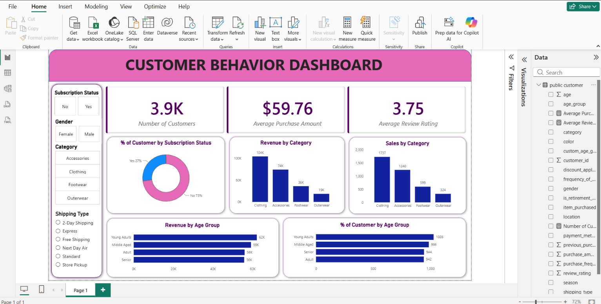

# 📊 E-Commerce Customer Behavior Analytics

An end-to-end **E-Commerce Customer Behavior Analytics** project designed to transform raw customer transaction data into actionable business insights.

This project covers the complete data analytics lifecycle — from **data cleaning and exploratory analysis in Python**, to **SQL-based business analysis**, **Power BI dashboard development**, and **executive-level reporting**.

The goal is to understand customer purchasing behavior, product performance, demographics, subscriptions, and revenue patterns to support better **marketing, customer retention, and business decisions**.

---

## 🚀 Project Overview

The project analyzes an e-commerce customer dataset containing approximately **3.9K unique customers**.

The analysis focuses on answering important business questions such as:

- Which customer segments generate the most revenue?
- Which product categories perform best?
- How does customer age affect purchasing behavior?
- What percentage of customers are subscribed?
- Which categories generate the highest sales?
- How can subscription conversion be improved?
- What customer groups should receive greater marketing attention?

The complete workflow transforms raw operational data into structured analysis and business recommendations.

---

## 📊 Dashboard Preview



---

# 🗂️ Dataset

The dataset contains approximately **3.9K unique customers** with information including:

- Customer ID
- Age
- Gender
- Purchase Amount
- Product Category
- Location
- Size
- Color
- Season
- Review Rating
- Subscription Status
- Shipping Type
- Discount Applied
- Promo Code Used
- Previous Purchases
- Payment Method

This dataset allows customer behavior to be analyzed across demographic, product, purchasing, and subscription dimensions.

---

# 🛠️ Tech Stack

| Technology | Purpose |
|---|---|
| 🐍 Python | Data cleaning & exploratory data analysis |
| 🐼 Pandas | Data manipulation |
| 🔢 NumPy | Numerical operations |
| 📊 Matplotlib | Data visualization |
| 📈 Seaborn | Statistical visualization |
| 🗄️ SQL | Business analysis & database querying |
| 📊 Power BI | Interactive dashboard |
| ⚡ DAX | KPI & calculated measures |
| 🔄 Power Query | Data transformation |
| 📑 Gamma | Executive presentation |

---

# 🔄 Project Workflow

```text
Raw E-Commerce Data
        ↓
Data Cleaning
        ↓
Exploratory Data Analysis
        ↓
SQL Business Analysis
        ↓
Power BI Dashboard
        ↓
Business Insights
        ↓
Recommendations
